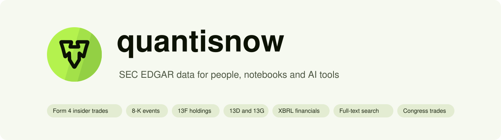

<picture>
  <source media="(prefers-color-scheme: dark)" srcset="assets/banner-dark.svg">
  
</picture>

Quantisnow reads every SEC filing as it lands on EDGAR and tags it to the ticker: Form 4 insider trades, 8-K events by item, 13F holdings, 13D and 13G stakes, XBRL financial statements and House members' stock trades. The same data is on [quantisnow.com](https://www.quantisnow.com), in the [SEC API](https://www.quantisnow.com/sec-api), and in the two repos below.

### [sec-edgar-mcp](https://github.com/quantisnow/sec-edgar-mcp)

A hosted MCP server and the `quantisnow` CLI. Ask your AI tool who bought NCLH stock this year, or which companies filed an 8-K item 4.02 last quarter, and it queries the filings directly.

```bash
claude mcp add --transport http quantisnow https://www.quantisnow.com/api/v1/mcp
```

```bash
npx quantisnow insiders NVDA --sells --days 90
```

<p>
  &nbsp;&nbsp;
  &nbsp;&nbsp;
  &nbsp;&nbsp;
  &nbsp;&nbsp;
  &nbsp;&nbsp;
  &nbsp;&nbsp;
  &nbsp;&nbsp;
  
</p>

### [sec-edgar-notebooks](https://github.com/quantisnow/sec-edgar-notebooks)

Jupyter notebooks that open in Colab. Five longer investigations keep the output from when we ran them, so you can read them without a key:

- [Where insiders bought their own stock in 2026](https://github.com/quantisnow/sec-edgar-notebooks/blob/main/notebooks/insider-buying-2026.ipynb): The Trade Desk's CEO made the largest purchase, $148 million in March.
- [Did insiders sell before their company said its books were wrong?](https://github.com/quantisnow/sec-edgar-notebooks/blob/main/notebooks/insider-sales-before-restatements.ipynb)
- [What House members traded in 2026, and how late they reported it](https://github.com/quantisnow/sec-edgar-notebooks/blob/main/notebooks/congress-stock-trades-2026.ipynb)
- [Red-flag 8-Ks in 2026 against 2025](https://github.com/quantisnow/sec-edgar-notebooks/blob/main/notebooks/red-flag-8ks-2026.ipynb)
- [New $100M positions in Q2 2026 13Fs](https://github.com/quantisnow/sec-edgar-notebooks/blob/main/notebooks/new-fund-positions-q2-2026.ipynb)

Every guide in the API docs with Python in it is there too, one notebook per guide, form type and theme.

### Links

[Website](https://www.quantisnow.com) · [SEC API docs](https://www.quantisnow.com/sec-api) · [Get a free API key](https://www.quantisnow.com/sec-api/keys) · [Pricing](https://www.quantisnow.com/sec-api/pricing) · [contact@quantisnow.com](mailto:contact@quantisnow.com)
